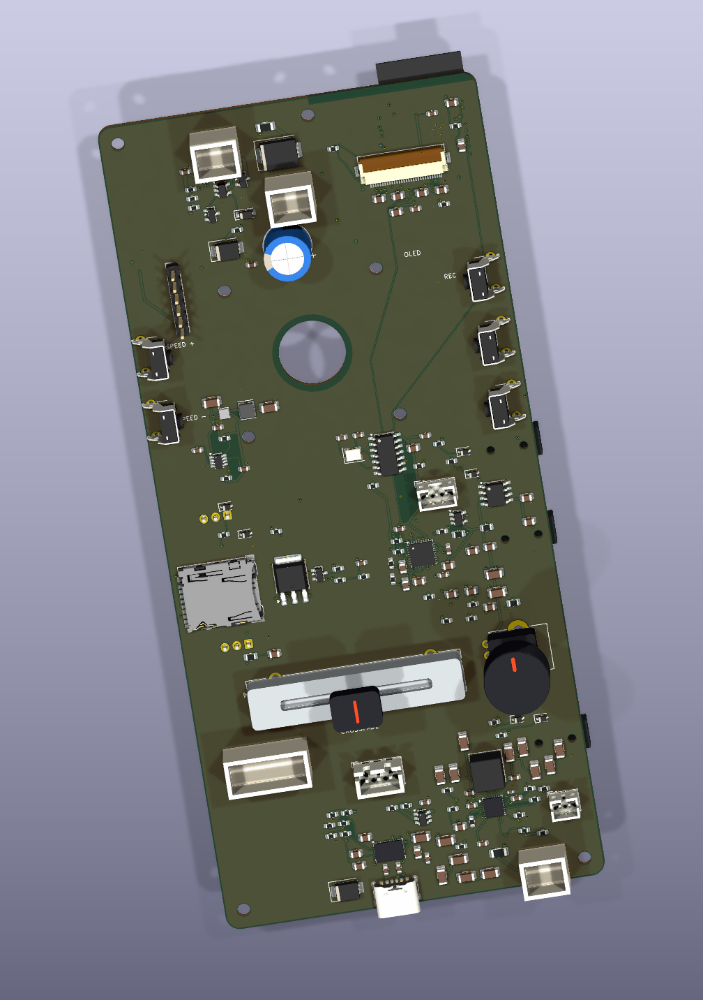

# DSH-5

I wanted a DJ deck I could hold in one hand. The DSH-5 has a motorized platter for scratching, a small OLED, one crossfader and one level knob. REC, MIX and PLAY are on the right edge. The seesaw on the left speeds up or slows down the track.

## Playing it

1. Put a stereo, 16-bit, 44.1 kHz `BACKING.WAV` on a microSD card. The deck loops the first 30 seconds. Add a `SCRATCH.WAV` for a separate sample. The wheel uses the backing track if there is no sample or recording.
2. Hold **PLAY** to turn it on. Tap **PLAY** to start or pause. Press either end of the seesaw to change the backing track speed.
3. Tap **MIX** to scratch. The motor lets the platter coast, and turning it moves the scratch sample. Use the crossfader to blend it with the backing track. The knob sets the output level.
4. Tap **REC** to capture up to eight seconds from line in. Tap it again to save the take and use it as the scratch sample.

## Design screenshots

### Enclosure and board

### Rev E PCB

## Rev E prototype

Rev E uses a solder-down ESP32-S3, a bare OLED, and an onboard stereo codec. The main board carries the crossfader, level pot, three side buttons and the two speed-seesaw contacts.

| What | Where |
| --- | --- |
| PCB | [KiCad project](hardware/rev-e/kicad/DSH-5-PCB-RevE.kicad_pro) · [board](hardware/rev-e/kicad/DSH-5-PCB-RevE.kicad_pcb) · [schematic](hardware/rev-e/kicad/DSH-5-PCB-RevE.kicad_sch) |
| Parts and sourcing | [Full BOM](BOM.csv) · [Fallen BOM](FALLEN-BOM.csv) |
| Mechanical reference | [Populated PCB STEP](cad/DSH-5-RevE-PCB.step.xz) |
| Wiring and assembly | [Hardware and turnkey assembly notes](hardware/rev-e/README.md) · [KiCad and firmware reports](hardware/rev-e/checks/) |
| Firmware | [ESP32-S3 source](firmware/rev-e/src/) · [PlatformIO project](platformio.ini) |

Run `pio run` from the repository root to build Rev E. Unpack the PCB model with `xz -dk cad/DSH-5-RevE-PCB.step.xz` and open the resulting STEP in Fusion.

KiCad reports zero errors and zero open connections, with two warnings documented in the hardware notes. The firmware builds. Physical fit, charging, audio and the motor still need first-article testing.

## Rev D files

The studio render and enclosure images above show Rev D. Its [enclosure and fit notes](cad/README.md), [KiCad source](hardware/kicad/DSH-5-PCB-RevD.kicad_pro), [turnkey quote files](hardware/manufacturing/pcba/), and [Teensy firmware](firmware/README.md) are available for that revision. The [Rev D BOM](https://github.com/DSHSTUDIOS/DSH-5/blob/5f626b1eb498d4edce1bb6fbd1a963682ae008fc/BOM.csv) is in the prior release commit.
