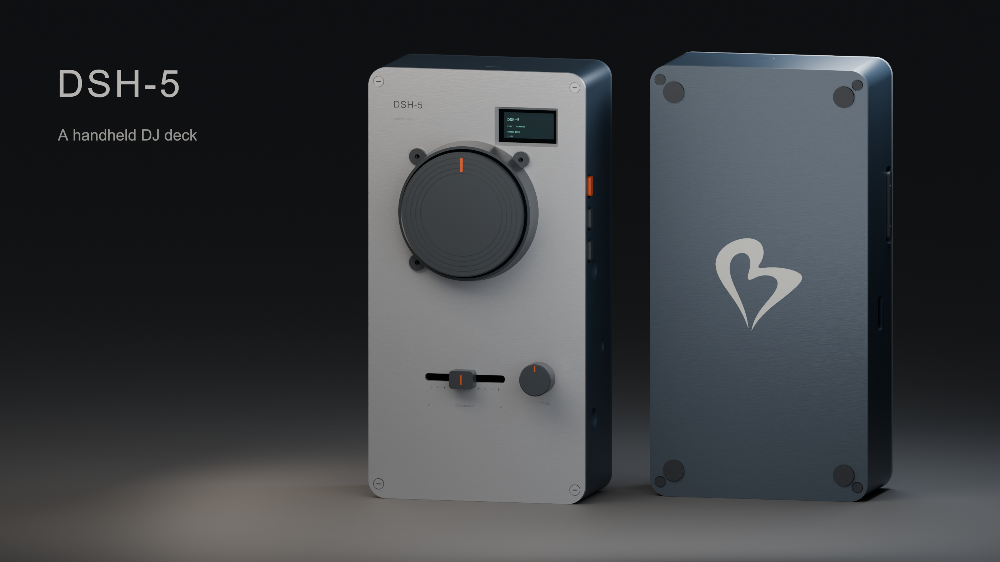
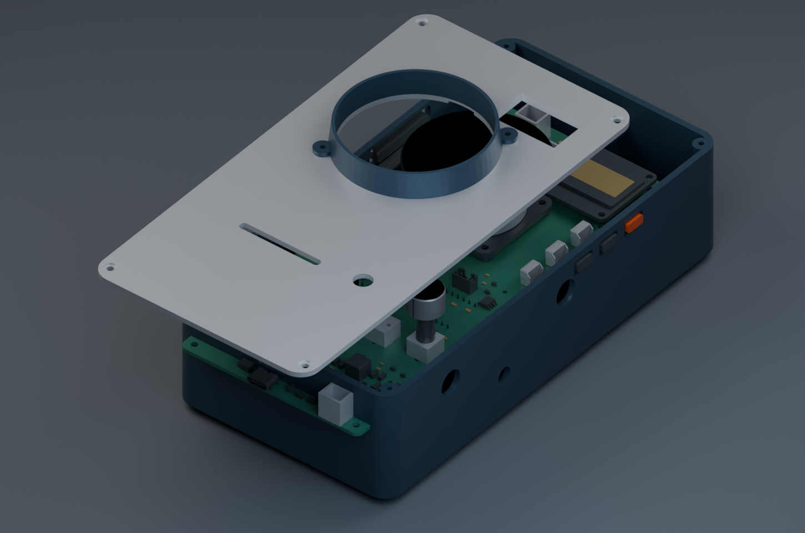
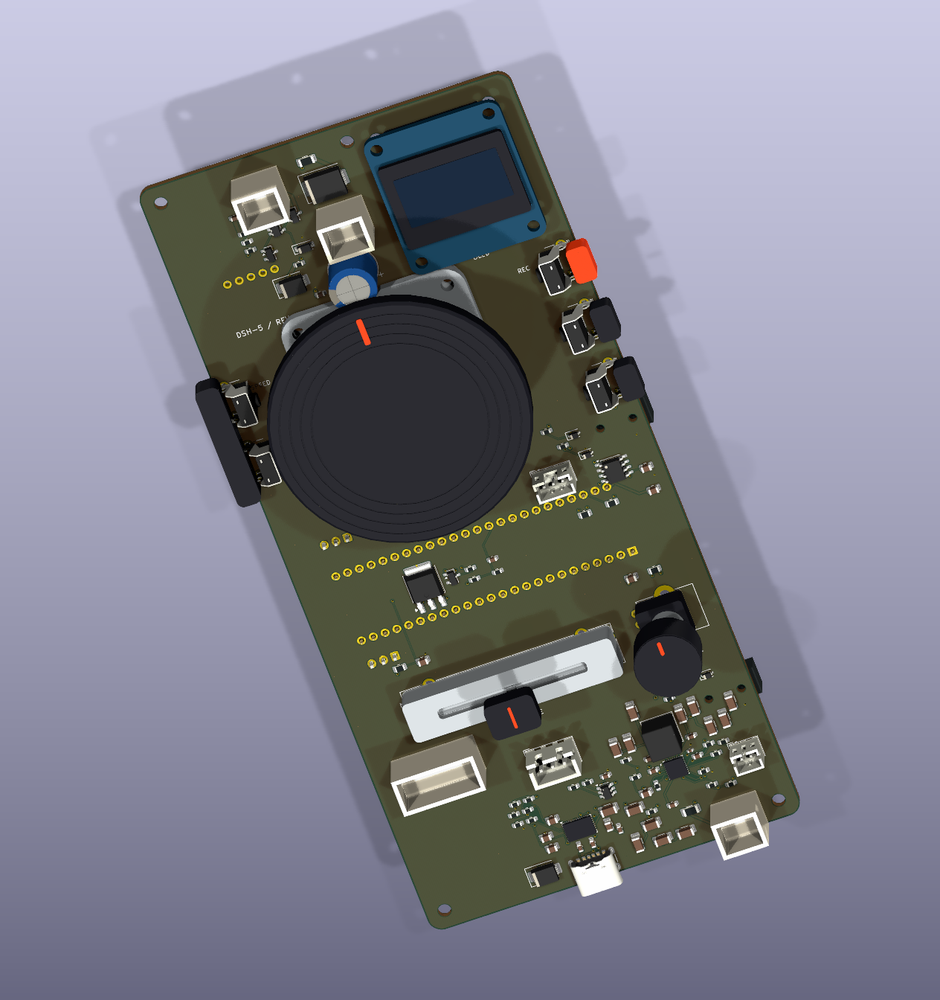
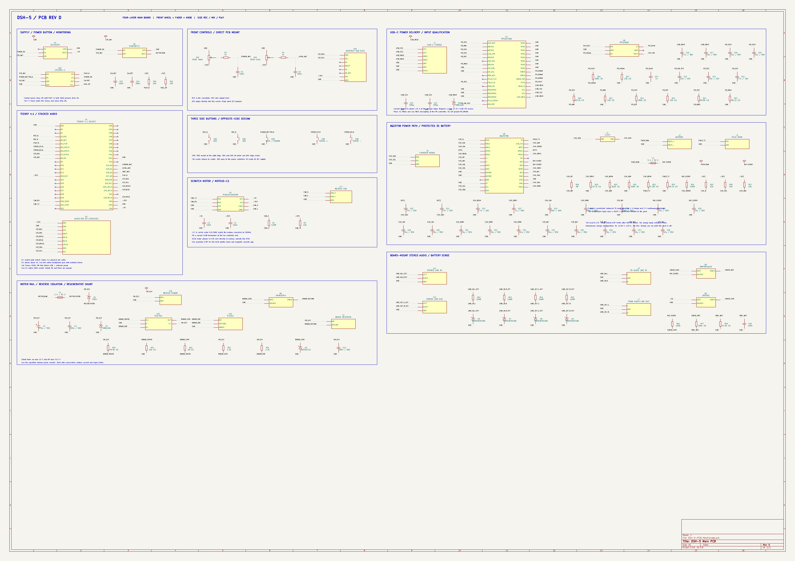

# DSH-5

I wanted a DJ deck I could hold in one hand. The DSH-5 has a motorized platter for scratching, a small OLED, one crossfader and one level knob. REC, MIX and PLAY are on the right edge. The seesaw on the left speeds up or slows down the track.

## Playing it

1. Put a stereo, 16-bit, 44.1 kHz `BACKING.WAV` on a microSD card. The deck loops the first 30 seconds. Add a `SCRATCH.WAV` for a separate sample. The wheel uses the backing track if there is no sample or recording.
2. Hold **PLAY** to turn it on. Tap **PLAY** to start or pause. Press either end of the seesaw to change the backing track speed.
3. Tap **MIX** to scratch. The motor lets the platter coast, and turning it moves the scratch sample. Use the crossfader to blend it with the backing track. The knob sets the output level.
4. Tap **REC** to capture up to eight seconds from line in. Tap it again to save the take and use it as the scratch sample.

## Design screenshots

### Enclosure and board

### Rev D PCB

### Schematic

## Making one

| What | Where |
| --- | --- |
| PCB | [KiCad project](hardware/kicad/DSH-5-PCB-RevD.kicad_pro) · [board](hardware/kicad/DSH-5-PCB-RevD.kicad_pcb) · [schematic](hardware/kicad/DSH-5-PCB-RevD.kicad_sch) |
| Fabrication and assembly | [Gerbers and drills](hardware/manufacturing/DSH-5-RevD-Gerbers.zip) · [turnkey quote files](hardware/manufacturing/pcba/) · [priced BOM](BOM.csv) |
| Enclosure | [Enclosure STEP](cad/DSH-5-RevD-Enclosure.step) · [populated PCB STEP](cad/DSH-5-RevD-PCB.step) · [full assembly and fit notes](cad/README.md) |
| Wiring and checks | [Assembly notes](hardware/README.md) · [ERC and DRC reports](hardware/verification/) |
| Firmware | [Build and flash instructions](firmware/README.md) · [source](firmware/src/) · [HEX](firmware/hex/DSH-5-RevD-Teensy41.hex) · [build settings](platformio.ini) |
| Studio render | [Blender scene](assets/blender/DSH-5-RevD-Studio.blend) |

Run `sh restore-cad.sh` to unpack the full assembly STEP, then open it in Fusion. The chassis is 96 × 187 mm and about 66 mm deep including the feet and knob. There’s room reserved for an internal battery, with USB-C PD charging on the main board.

## Building the firmware

Run `pio run` from the repo root. The [firmware guide](firmware/README.md) covers flashing a Teensy 4.1, preparing the microSD card, and recovering an interrupted take.

**Status.** This is the Rev D prototype. KiCad checks passed, the firmware built, and the CAD clears the full fader and platter travel. The pictures are renders. Charging, scratching, and final fit still need testing on a physical deck.
